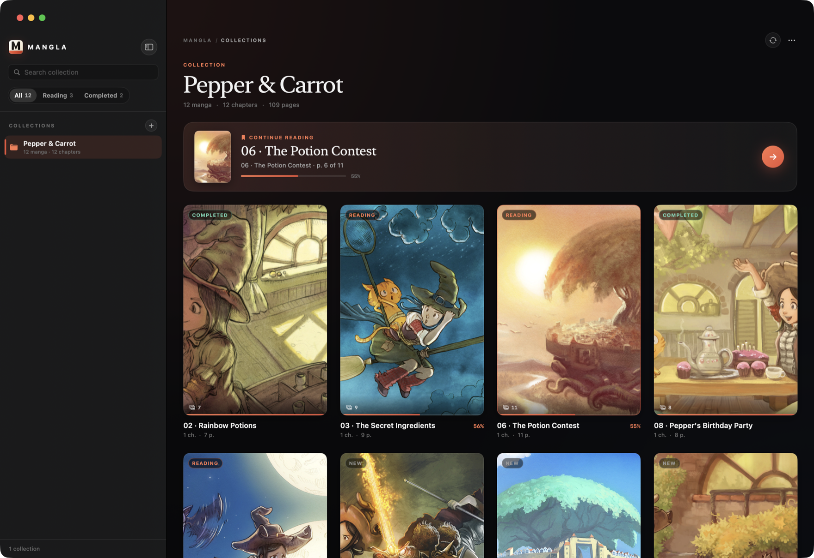
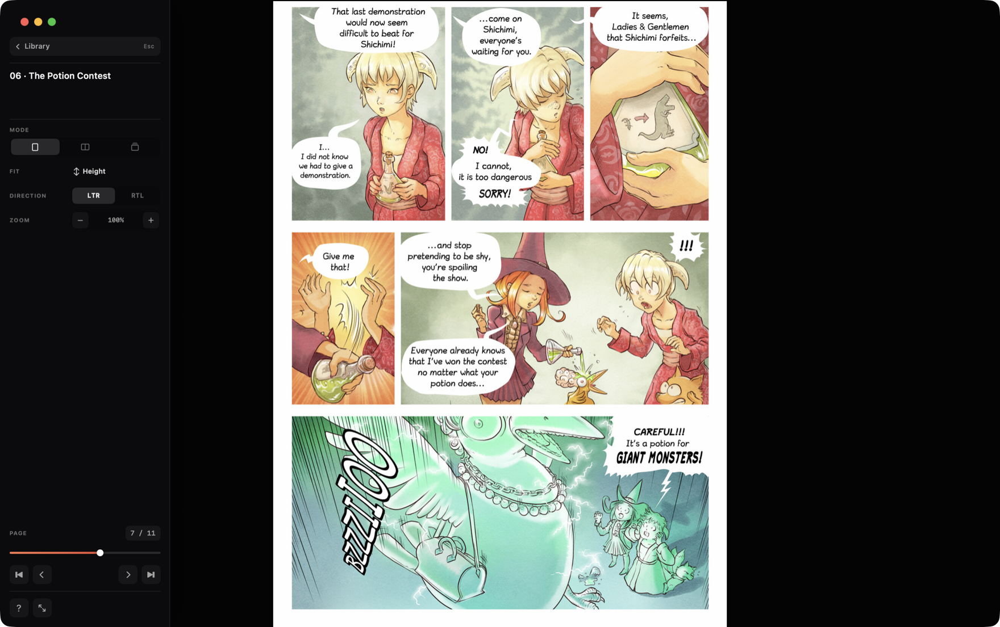

# Mangla

A native macOS manga reader built with Swift 6, SwiftUI, and AppKit. No web view, no network access, and no writes into your manga folders.

## Screenshots



*Library — covers, reading status, filters, and Continue Reading.*



*Reader — single page with the page sidebar open.*

The screenshots use [Pepper&Carrot](https://www.peppercarrot.com/) by David Revoy (CC BY 4.0) as demo content.

## Features

- Multiple collection folders open at once, with security-scoped bookmarks.
- Grid library with covers, reading status, filters, search, and 30 items per page.
- Single-page, two-page spread, and continuous webtoon reading modes.
- RTL and LTR reading directions; wide scans stay on their own spread.
- Native AppKit zoom from 1x to 5x, anchored at the pointer, with trackpad panning.
- Click zones, two-finger swipes, mouse side buttons, keyboard shortcuts, and a shortcut cheat sheet.
- Per-collection progress for every manga and chapter, restored on launch.
- English and Russian interface, selected from the system language.
- Folder watching for new manga, chapters, and pages.
- Image folders, CBZ/CBR archives, and PDF files in the same collection.

## Requirements

- macOS 15 or later.
- Xcode 16 or later with the Swift 6 toolchain to build from source.

## Install

Download `Mangla-<version>-macos.zip` from [Releases](https://github.com/x429d/mangla/releases), unzip it, and move `Mangla.app` to Applications.

The current build is ad-hoc signed and not notarized. On first launch, right-click the app and choose **Open**, or use **System Settings > Privacy & Security > Open Anyway**. Do not disable Gatekeeper globally.

### Build from source

```bash
swift build -c release
swift test
./Scripts/build-app.sh
open Mangla.app
```

`Scripts/build-app.sh` reads the version from `VERSION`, writes it into `Info.plist`, and ad-hoc signs the bundle. For a debug bundle, run `./Scripts/build-app.sh debug`.

## Usage

Add one or more folders with **Add Collection** (`Cmd+O`). Folders, archives, and PDFs can be mixed freely:

```text
Collection/
  Manga/
    001.webp
    002.jpg
  Manga with chapters/
    Chapter 01/
      001.png
    Chapter 02.cbz
    Chapter 03.pdf
  One Shot.cbz
```

A collection folder may itself be a single manga. Inside a manga folder, image folders and archive/PDF files each become one chapter; a loose `.cbz`, `.cbr`, or `.pdf` at the collection root becomes its own manga. Pages are sorted by name without the extension, so `1.webp`, `2.jpg`, and `10.png` stay in order.

Supported page images are `.webp`, `.jpg`, `.jpeg`, `.png`, `.avif`, and `.heic`. Archives may be `.cbz` or `.cbr`; their format is detected from the file contents, so a RAR renamed to `.cbz` (or a ZIP renamed to `.cbr`) still opens. Hidden files, `__MACOSX`, AppleDouble companions, and symlinks are ignored, both on disk and inside archives.

Development flags:

```bash
.build/debug/Mangla --project /path/to/library
MANGLA_LANGUAGE=ru .build/debug/Mangla --project /path/to/library
```

| Action | Keys |
| --- | --- |
| Previous / next page (visual) | `Left` / `Right`, `A` / `D` |
| Previous / next page (reading order) | `,` / `.`, `K` / `J` |
| Screen or page forward / back | `Space` / `Shift+Space`, `Page Down` / `Page Up` |
| Previous / next chapter | `[` / `]`, `Cmd+Left` / `Cmd+Right` |
| Single page / spread / webtoon | `1` / `2` / `3` |
| Reading direction | `T` |
| Fit height / width / actual size | `H` / `W` / `O` |
| Zoom in / out / reset | `+` / `-` / `0` |
| Go to page | `G`, type a number, `Enter` |
| Full screen | `F` or `Ctrl+Cmd+F` |
| Shortcut cheat sheet | `?` |
| Back to library | `Esc` or `Cmd+Shift+W` |

Reader commands are read by physical key position, so they work on non-US layouts. The in-app cheat sheet lists the mouse and trackpad gestures as well.

## Limitations

- CBZ (ZIP) archives are read natively. CBR (RAR) archives use the system `bsdtar` (libarchive 3.7 on macOS 15). Password-protected or unsupported archives are skipped, and the skip is logged.
- PDF pages are rendered on demand at about 2x their page size, with a sharper re-render when the zoom passes 2.2x.
- Extracted CBR pages are cached in `~/Library/Caches/Mangla/Archives/`, capped at 2 GB. Nothing is ever written next to your manga.
- Chapter traversal stops at 8 folder levels. Deeper folders are skipped and the skip is logged.
- Folder watching covers the collection root, manga folders, and chapter folders, capped at 200 watched directories per collection. Larger libraries need **Refresh** (`Cmd+R`) for changes beyond the cap.
- Progress is keyed by folder path. Renaming a manga or chapter outside the app starts that item from zero; the collection bookmark itself can survive a move.
- Actual Size maps one image pixel to one point. On a Retina display this is deliberately larger than one physical pixel.
- Full-resolution pages are decoded on demand. Large scans can use hundreds of megabytes per page; the shared cache is bounded to about 700 MB and 48 images, and is released when the reader closes.
- Library pagination is fixed at 30 manga per page. The card context menu lists the first 40 chapters; use the reader to continue past that.
- The app is not sandboxed and is distributed ad-hoc signed. App Sandbox, notarization, and a Developer ID are post-1.0 work.
- One window and one `state.json` per user.

## Privacy

Mangla makes no network requests and has no telemetry or analytics. It only reads the folders you add. State and reading progress are written to `~/Library/Application Support/Mangla/`, extracted CBR pages to `~/Library/Caches/Mangla/`, never into the manga folders. `state.json` is written atomically and keeps a `state.json.bak` fallback.

## Architecture

`Sources/Mangla` is split into `App`, `Core`, `Models`, and `UI`. `AppModel` owns collections, scanning, progress, and persistence. `ReadingSession` owns one open chapter and its navigation state. AppKit canvases (`PageCanvasView`, `WebtoonCanvasView`) handle rendering and native magnification; SwiftUI builds the library and reader chrome. `LibraryScanner` walks the filesystem, `ImagePrefetcher` decodes off the main actor, and `StateStore` persists state. All UI types are `@MainActor`; shared value types are `Sendable`.

## Contributing and License

Read [CONTRIBUTING.md](CONTRIBUTING.md) before opening a pull request. Report security issues through [SECURITY.md](SECURITY.md). Mangla is released under the [MIT License](LICENSE).
