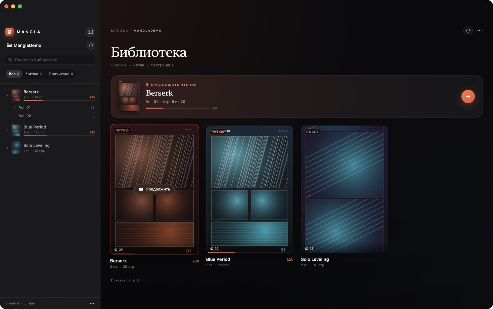
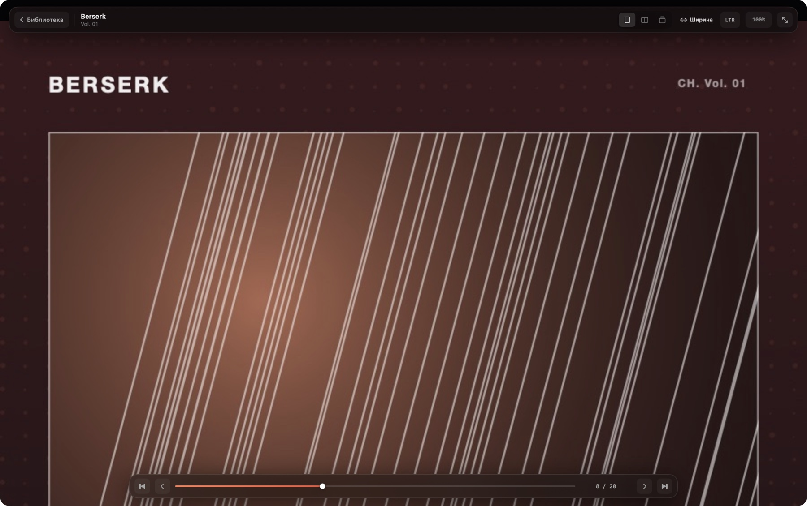

# Mangla

Нативная читалка манги для macOS: Swift 6, SwiftUI и AppKit, без Electron и веб-вью.
Библиотека папок, смешанные форматы страниц, нативный трекпадный зум и три режима чтения —
одиночная страница, разворот и вертикальная лента.





## Возможности

- **Проект-папка.** Выбираете корневую папку, приложение рекурсивно находит манги и главы.
  Поддерживаются оба варианта вложенности:
  `Проект → Манга → Страницы` и `Проект → Манга → Глава → Страницы`.
- **Смешанные форматы.** `.webp`, `.jpg`, `.jpeg`, `.png`, `.avif`, `.heic` в одной папке.
  Страницы сортируются по имени **без расширения** через `localizedStandardCompare`:
  `1.webp → 2.webp → 3.jpg → 10.jpg → 20.webp`.
- **Сетка библиотеки.** Адаптивные карточки с обложками, числом страниц и глав, статусом
  («Читаю», «Прочитано») и прогрессом. Обложка — первая страница, декодированная в
  thumbnail через `CGImageSourceCreateThumbnailAtIndex` (без загрузки полного битмапа).
- **Три режима чтения.**
  - одиночная страница: вписать по высоте, по ширине или оригинальный размер;
  - разворот из двух страниц с поддержкой RTL (манга) и LTR; широкий скан (`width > height`)
    автоматически показывается один и не ломает чётность следующих разворотов;
  - Webtoon: непрерывная вертикальная лента без зазоров с общим аппаратным зумом.
- **Нативный зум AppKit.** `NSScrollView` с `allowsMagnification` (1×–5×), пинч в точку
  курсора, инерционное панорамирование с упругими краями. Никаких `.scaleEffect` и
  `MagnifyGesture` для страниц.
- **Smart Zoom.** Двойной клик (или double-tap двумя пальцами) плавно приближает к точке
  клика до 2.5× и сбрасывает обратно к 1×. Анимация идёт по `CADisplayLink`, а не таймеру.
- **Свайпы.** На масштабе 1× горизонтальный свайп двумя пальцами переключает страницы;
  при зуме > 1× тот же жест панорамирует страницу с нативной инерцией.
- **Плавающий HUD.** Верхняя панель (назад, манга/глава, режим, вписывание, RTL/LTR,
  процент зума) и нижний контроллер (слайдер, `8 / 20`, превью страницы при наведении)
  всплывают при движении мыши и скрываются через 2 секунды бездействия. Курсор тоже
  скрывается в режиме чтения.
- **Прелоадер.** `actor ImagePrefetcher` с `NSCache`: декодирование в фоне через ImageIO,
  `kCGImageSourceShouldCacheImmediately`, 4 страницы вперёд, 2 назад; спекулятивные
  загрузки далёких страниц отменяются при быстром скролле/перелистывании.
- **Прогресс и восстановление.** Путь проекта, security-scoped bookmark, последняя
  манга/глава/страница и прогресс по каждой главе сохраняются локально. При запуске
  библиотека открывается на том же проекте, а карточка «Продолжить чтение» ведёт на
  последнюю позицию.
- **Живое обновление.** `DispatchSourceFileSystemObject` следит за корнем проекта и
  папками манг: новая манга или глава появляется без ручного обновления. Кнопка
  «Обновить» и `⌘R` делают полный рескан.
- **Светлая/тёмная тема.** Приложение работает в тёмной эстетике macOS с
  `.ultraThinMaterial`, пружинными анимациями и акцентным «персиковым» цветом.

## Требования

- macOS 15 Sequoia или новее (сборка проверена на macOS 26/27, Swift 6.4, Xcode 27).
- Xcode 16+ / Swift 6 toolchain.
- Apple Silicon рекомендуется; приложение собирается под архитектуру хоста (на Intel — x86_64).

## Сборка и запуск

### Swift Package Manager

```bash
swift build -c release
swift run -c release Mangla
```

`swift run` запускает обычный исполняемый файл, но `AppDelegate` сам вызывает
`setActivationPolicy(.regular)` и `activate`, поэтому окно получает фокус и события
клавиатуры/трекпада.

### Сборка `.app`

```bash
./Scripts/build-app.sh          # release по умолчанию
open Mangla.app
```

Скрипт собирает релизный бинарник, складывает его в `Mangla.app` с `Info.plist`,
иконкой и ad-hoc подписью. Папка `Mangla.app` в git не попадает.

Для отладки:

```bash
./Scripts/build-app.sh debug
```

### Полезные флаги для разработки

```bash
# открыть конкретный проект, минуя сохранённый
.build/debug/Mangla --project /path/to/library

# сразу открыть читалку на последней позиции (для скриншотов/проверки)
.build/debug/Mangla --project /path/to/library --open-reader
```

## Структура библиотеки

```
MyManga/
├── Berserk/
│   ├── Vol. 01/
│   │   ├── 1.webp
│   │   ├── 2.webp
│   │   ├── 3.jpg
│   │   └── 10.jpg
│   └── Vol. 02/
│       └── 001.png …
├── Blue Period/
│   ├── 1.jpg
│   └── 2.webp
└── Solo Leveling/
    ├── Chapter 01/
    │   └── 1.webp …
    └── Chapter 02/
        └── 1.webp …
```

Правила сканера:

- папка, в которой лежат изображения, считается главой;
- папка с подпапками-главами считается мангой;
- корень проекта тоже может быть одной мангой;
- вложенность глубже двух уровней поддерживается: название главы — относительный путь;
- скрытые файлы, `._*`, `__MACOSX` и симлинки игнорируются;
- регистр расширений не важен.

## Управление

| Действие | Клавиши / жест |
| --- | --- |
| Следующая / предыдущая страница | `→` / `←` (в RTL зеркально), `D` / `A`, `Space` / `PageDown`, `PageUp` |
| Первая / последняя страница | `Home` / `End` |
| Режим: одна страница / разворот / webtoon | `1` / `2` / `3` |
| Направление чтения | `T` |
| Вписать по высоте / ширине / оригинал | `H` / `W` / `O` |
| Сбросить зум | `⌘0` или клик по проценту в HUD |
| Увеличить / уменьшить | `⌘=` / `⌘-` |
| Полный экран | `F` или `⌃⌘F` |
| Назад в библиотеку | `Esc` или `⌘⇧W` |
| Открыть проект | `⌘O` |
| Обновить проект | `⌘R` |
| Показать/скрыть сайдбар | `⌘\` |
| Выход | `⌘Q` |

Жесты:

- пинч двумя пальцами — зум 1×–5× в точку курсора;
- два пальца при зуме > 1× — панорамирование с инерцией и bounce;
- горизонтальный свайп при 100% — перелистывание;
- двойной клик / smart magnify — 2.5× или сброс;
- наведение на нижний слайдер — превью страницы;
- перетаскивание слайдера — быстрый переход по главе.

По достижении последней страницы следующий свайп/нажатие автоматически открывает
следующую главу (или следующую мангу проекта); внизу появляется кнопка «Следующая глава».

## Как это устроено

```
Sources/Mangla/
├── App/
│   ├── AppDelegate.swift      # NSApplication, окно, меню, клавиатура
│   ├── AppModel.swift         # библиотека, прогресс, выбор проекта, сканирование
│   └── ReadingSession.swift   # состояние читалки, главы, развороты, HUD, зум
├── Core/
│   ├── LibraryScanner.swift   # рекурсивный сканер и естественная сортировка
│   ├── ImageDecoder.swift     # ImageIO: полный декод и thumbnails
│   ├── ImagePrefetcher.swift  # actor + NSCache + отмена спекулятивных загрузок
│   ├── ImageProviders.swift   # ThumbnailProvider, MetadataProbe, DecodeGate
│   ├── PageLayout.swift       # расчёт разворотов и вписывания
│   ├── Persistence.swift      # state.json, bookmark, настройки
│   └── ProjectWatcher.swift   # DispatchSource-наблюдатели папок
├── Models/
│   └── LibraryModels.swift    # PageItem, ChapterItem, MangaItem, прогресс
└── UI/
    ├── Theme.swift            # палитра, типографика, общие компоненты
    ├── RootView.swift         # библиотека ↔ читалка
    ├── Library/               # сайдбар, сетка, карточки, пустые состояния
    └── Reader/
        ├── ReaderCanvas.swift        # NSScrollView, tracking, CADisplayLink-зум
        ├── PageCanvasView.swift      # страница/разворот (NSViewRepresentable)
        ├── WebtoonCanvasView.swift   # вертикальная лента
        ├── ReaderView.swift          # полноэкранный слой, HUD, toast
        └── ReaderHUD.swift           # верхняя/нижняя панели и слайдер с превью
```

### Рендеринг

`MangaPageCanvas` — это `NSViewRepresentable` над кастомным `NSScrollView`.
Документ-вью всегда не меньше вьюпорта, страница центрируется внутри, поэтому при
масштабе 1× страница центрирована, а при зуме контейнер растягивается нативно.

- `allowsMagnification = true`, `min = 1`, `max = 5`;
- пинч обрабатывается в `magnify(with:)` и вызывает
  `setMagnification(_:centeredAt:)` с точкой в координатах clip view;
- смарт-зум анимируется `ZoomAnimator` через `CADisplayLink` (ease-out cubic);
- при `zoom == 1` горизонтальный `scrollWheel` перехватывается и превращается в
  page-flip; при `zoom > 1` событие уходит в `super` — работает штатная инерция AppKit;
- двойной клик обрабатывается `PageContentView.mouseDown`, координата конвертируется
  в clip view и передаётся в аниматор.

Разворот — это просто две `PageContentView` рядом внутри surface; RTL меняет порядок
кадров, а широкая страница формирует спред из одного элемента в `SpreadBuilder`.

### Декодирование и память

- Полные страницы декодируются `CGImageSourceCreateImageAtIndex` с
  `kCGImageSourceShouldCacheImmediately: true` в `Task.detached`.
- `ImagePrefetcher` — actor с `NSCache` (лимит ~700 МБ / 48 изображений). Видимые
  страницы имеют приоритет `userInitiated`, префетч — `utility`; спекулятивные задачи
  можно отменять, а запрос видимой страницы «повышается» из префетча и не отменяется.
- `MetadataProbe` читает только заголовки (`CGImageSourceCopyPropertiesAtIndex`), чтобы
  заранее знать размеры страниц и корректно строить развороты.
- Обложки и превью — `ThumbnailProvider` с `DecodeGate(limit: 4)` и отдельным кэшем.

### Конкурентность Swift 6

Все UI-классы изолированы на `@MainActor`. Сканирование, декодирование, запись состояния
и чтение метаданных выполняются вне главного актора; модели `PageItem` / `ChapterItem` /
`MangaItem` — `Sendable`-структуры. Состояние пишется через сериализующий `StateWriter`,
а прогресс сохраняется с дебаунсом 450 мс и синхронно при завершении приложения.

## Где хранятся данные

- `~/Library/Application Support/Mangla/state.json` — проект, прогресс, последняя манга.
- `~/Library/Preferences/com.mangla.reader.plist` — bookmark проекта, режим чтения,
  вписывание, направление (общий suite для `swift run` и `.app`).
- Позиция окна — стандартный frame autosave.
- В папки с мангой приложение **ничего не пишет**.

## Тесты

```bash
swift test
```

11 тестов: рекурсивный сканер, смешанные расширения, естественная сортировка глав,
манга с cover-файлом в корне, проект-как-манга, развороты с широкими сканами и
математика `fitHeight` / `fitWidth` / `original`.

## Ограничения

- Поддерживаются только папки с изображениями; CBZ/CBR/PDF не открываются.
- «Оригинальный размер» трактует 1 пиксель изображения как 1 point; на Retina это
  осознанно крупнее физического пикселя.
- Очень большие сканы декодируются в полном разрешении (это цена отсутствия микрофризов);
  при гигантских библиотеках стоит следить за потреблением памяти.
- Наблюдатели папок покрывают корень проекта и папки манг; новые страницы внутри уже
  существующей главы подхватываются кнопкой «Обновить»/`⌘R`.
- Приложение не sandboxed и подписано ad-hoc; для распространения нужна подпись
  Developer ID и, при желании, entitlements с security-scoped bookmarks.
- Первая страница не выделяется в отдельный «ковер»: разворот начинается с пар 1–2.

## Скрипты

- `Scripts/build-app.sh [release|debug]` — сборка `.app`.
- `Scripts/make-icon.swift` — генерация исходной иконки 1024×1024 (PNG).
  `Resources/AppIcon.icns` уже собран и используется бандлом.
